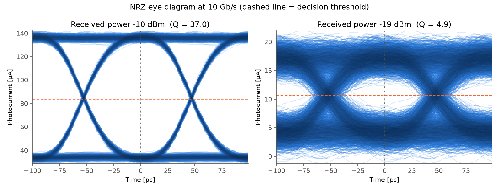
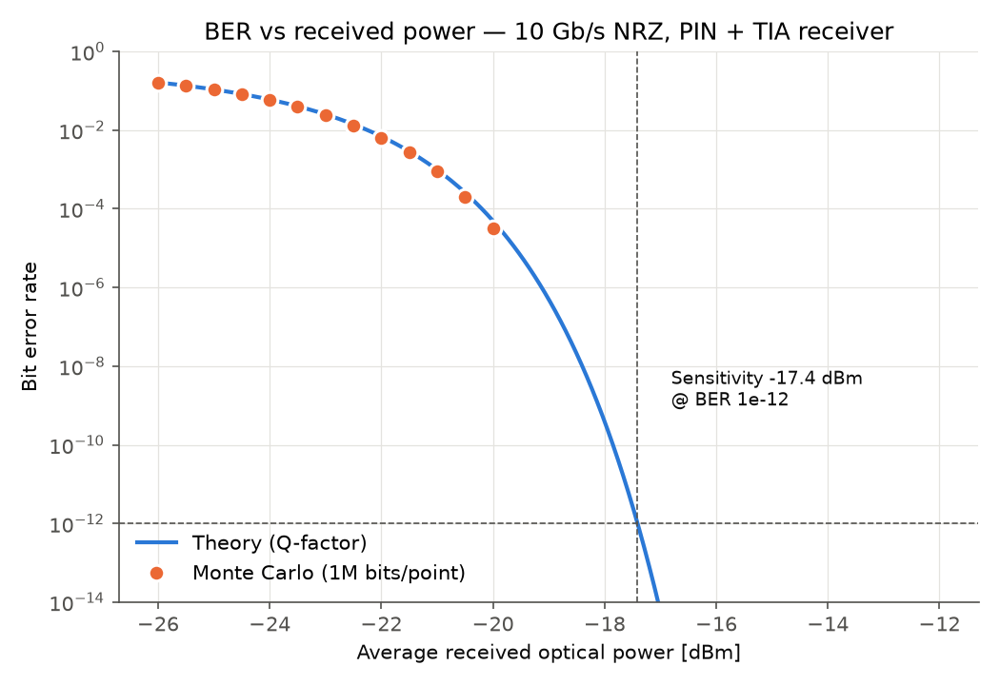

# Optical Link Simulator

Simulation of a 10 Gb/s NRZ optical link (laser → fiber → PIN photodiode + TIA) in Python.
Covers eye diagrams, BER vs received power (Monte Carlo vs Q-factor theory), receiver
sensitivity, and an attenuation-limited link budget.

> This is a simulation project. Device parameters are typical assumed values, not measurements.

## Results (Part 1)

| Eye diagram | BER vs received power |
|---|---|
|  |  |

- Receiver sensitivity: **−17.4 dBm** at BER 1e-12 (Q = 7.03)
- Monte Carlo (1M bits/point) agrees with theory within ~0.1 dB
- Max reach: **26 km** for −3 dBm launch power, 0.4 dB/km fiber, 3 dB margin

## Model

- NRZ levels from average power and extinction ratio (6 dB)
- Receiver bandwidth: 4th-order Bessel low-pass at 0.75 × bit rate
- Noise: TIA thermal noise (15 pA/√Hz) + signal-dependent shot noise
- Q = (I1 − I0)/(σ1 + σ0), BER = ½·erfc(Q/√2), optimum decision threshold

## Run

```bash
pip install -r requirements.txt
python part1_nrz_ber.py
```

Or open `part1_nrz_ber.py` in VS Code and run it cell by cell (`# %%` cells).

## Roadmap

- [x] Part 1: NRZ eye diagram, BER curve, sensitivity, link budget
- [ ] Part 2: TIA design in LTspice (bandwidth, noise, stability)
- [ ] Part 3: feed LTspice results into the system model
- [ ] Part 4: NRZ vs PAM4
