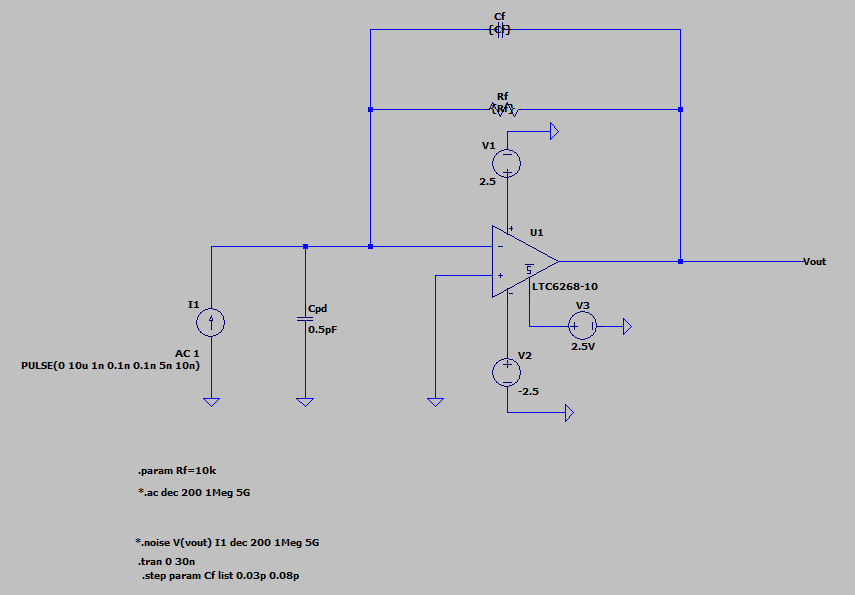
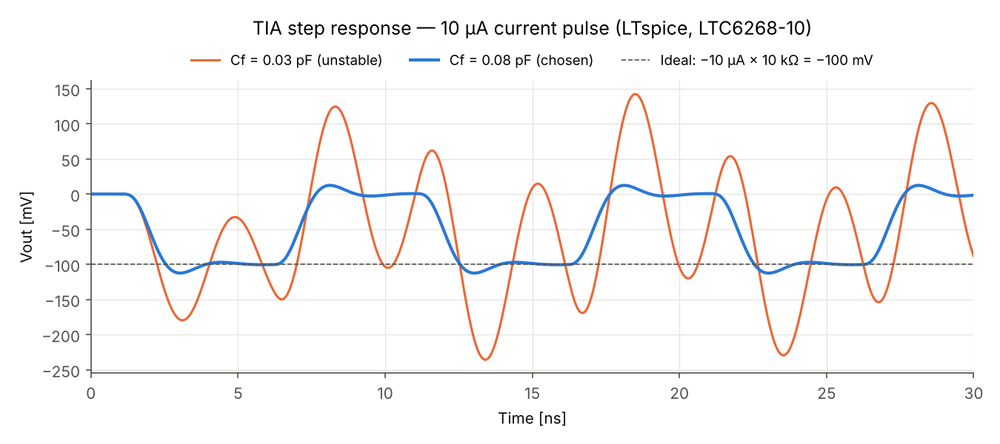

# Optical Link Simulator

Simulation of a 10 Gb/s NRZ optical link (laser → fiber → PIN photodiode + TIA) in Python.
Covers eye diagrams, BER vs received power (Monte Carlo vs Q-factor theory), receiver
sensitivity, and an attenuation-limited link budget.

> This is a simulation project. Device parameters are typical assumed values, not measurements.

## Results (Part 1)

| Eye diagram | BER vs received power |
|---|---|
|  |  |

- Receiver sensitivity: **−17.4 dBm** at BER 1e-12 (Q = 7.03)
- Monte Carlo (1M bits/point) agrees with theory within ~0.1 dB
- Max reach: **26 km** for −3 dBm launch power, 0.4 dB/km fiber, 3 dB margin

## Results (Part 2): TIA design in LTspice

A real receiver front-end built around the **LTC6268-10** (4 GHz GBW FET-input op amp) and
simulated in LTspice. A discrete op amp cannot reach 10 Gb/s, so the TIA targets
**622 Mb/s (SONET OC-12)**; the design method is the same.



| Parameter | Target | Result |
|---|---|---|
| Rf / Cf | – | 10 kΩ / 0.08 pF |
| Transimpedance | – | 80 dBΩ (10 kΩ) |
| −3 dB bandwidth | ≈ 0.7 × 622 Mb/s | **≈ 430 MHz** |
| Peaking | ≤ 1 dB | **≈ 0.3 dB** |
| Rise time (10–90 %) | – | 0.87 ns |
| Step overshoot | – | 12 % |
| Input noise density | – | 1.5 pA/√Hz @ 10 MHz, 16.6 pA/√Hz @ 300 MHz |
| Input-referred noise (integrated) | – | **≈ 336 nA rms** |

Assumptions: ±2.5 V supply, photodiode modeled as a current source in parallel with 0.5 pF.



### Design notes

- **Decompensated op amp.** The LTC6268-10 is only stable at a noise gain of about 10 or more.
  At Rf = 3 kΩ no value of Cf worked: small Cf gave up to 20 dB of peaking, while larger Cf
  lowered the high-frequency noise gain and exposed the op amp's own resonance.
  Raising Rf to 10 kΩ gave a stable design with a flat response.
- **Cf sweep at Rf = 10 kΩ.** 0.06 pF → +4 dB peaking, 0.07 pF → +2 dB, **0.08 pF → +0.3 dB**,
  0.09 pF → no peaking but earlier roll-off. Cf = 0.03 pF oscillates continuously (see step response).
- **Noise.** At low frequency the noise is set by the thermal noise of Rf (≈ 13 nV/√Hz at the output).
  Near 300 MHz the op amp voltage noise acting on the input capacitance (en·2πfC) dominates
  and rises with frequency, so the integrated rms value is used instead of a flat density.

## Model (Part 1)

- NRZ levels from average power and extinction ratio (6 dB)
- Receiver bandwidth: 4th-order Bessel low-pass at 0.75 × bit rate
- Noise: TIA thermal noise (15 pA/√Hz) + signal-dependent shot noise
- Q = (I1 − I0)/(σ1 + σ0), BER = ½·erfc(Q/√2), optimum decision threshold

## Run

```bash
pip install -r requirements.txt
python part1_nrz_ber.py      # Part 1: link model
python part2_tia_plots.py    # Part 2: plots from LTspice exports in ltspice/
```

Or open the scripts in VS Code and run them cell by cell (`# %%` cells).
The LTspice schematic is `ltspice/tia.asc` (requires the free LTspice to open).

## Roadmap

- [x] Part 1: NRZ eye diagram, BER curve, sensitivity, link budget
- [x] Part 2: TIA design in LTspice (bandwidth, noise, stability)
- [ ] Part 3: feed LTspice results into the system model
- [ ] Part 4: NRZ vs PAM4
